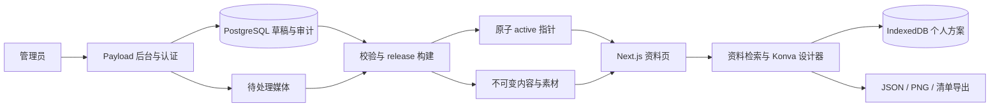

# 02 技术方案：内容平台、场景与发布

日期：2026-11-06。状态：设计建议，待需求及技术评审；本轮没有实施产品代码、安装依赖或部署服务。范围仅限 `fishatlas-site`，与上级 Unity 项目独立。

## 1. 现状与推荐结论

已核对 `README.md`、`app.js`、`index.html`、`data/*.json`、`schemas/README.md` 和 `scripts/`。当前为无构建依赖的原生 JS 网站，10 个淡水动物、20 条中英本地化、10 个饲养档案、4 条混养关系；没有数据库、CMS、真实管理员认证、植物/材料模型或开缸设计器。`tank_profiles.json` 与 `tank_plan_items.json` 均为 `[]`；P1 计算器是占位页。筛选分类、类型和大量标签词典在 JS 和校验器中硬编码。现有图片是占位或缺图状态。

现有 `index.html` 的资源版本 query、`app.js` 透传版本并 `no-store` 获取 JSON、预览服务的 `no-store` 解决本地缓存复用，但不是生产环境的内容快照、跨节点一致性和回滚机制。生产不能继续覆盖相同 URL 下的整组 JSON 并假定缓存同时刷新。

**推荐：Next.js + TypeScript + Payload CMS + PostgreSQL + S3 兼容对象存储 + React/Konva。** Next.js 负责可索引资料页与前台，Payload 提供成熟编辑后台、关系字段、媒体和草稿版本；在其上补充分类/参数表单、编辑校验和 release 发布服务。Konva 仅用于客户端设计器，规则和方案文档独立于画布库。第一阶段同一代码仓库，前台与管理入口逻辑隔离；后台 API 默认拒绝匿名，公开前台只读已发布快照。

这里推荐的是评审方案，不代表用户已选定技术栈；实施前验证 Payload/Next 的当前稳定版本、运行时、Postgres adapter、对象存储 adapter 的兼容组合并锁版本。CMS 自带的单文档“发布”不等于本方案的整库原子发布，需明确这部分定制工作量。

| 路线 | 适用理由 | 成本与限制 | 结论 |
|---|---|---|---|
| Next.js/TS + Payload + Postgres + 对象存储 + Konva | 代码和内容模型同用 TS；前后台类型约束可共享；适合规则、模板与复杂关联；资料页 SEO 与设计器可同站交付 | 需要 Node 长期运行环境、数据库运维及 Payload 定制；前后台升级耦合，需集成测试 | 推荐。团队接受 TS/React 与少量后台定制时整体最连贯 |
| Next.js/TS + Directus + Postgres + 对象存储 + Konva | 后台独立部署；表结构与管理界面成熟；内容团队不依赖前端发布 | 另建类型契约、发布聚合服务及规则编辑器；管理权限/扩展需逐项验证；商业部署先确认当期许可条件，无需建立内容来源/许可登记工作流 | 若已有 Directus 经验或后台需服务多个产品，这是合理替代 |
| 保留静态前台，增加构建发布流水线与 Git/文件型后台 | 沿用现有资源、托管成本低、资料页可预生成，设计器仍可纯客户端 | 分类/参数/模板关系越复杂，定制后台、权限和并发编辑成本越高；Git 不是成熟业务 CMS；若增加成熟 CMS 后静态导出，仍须建设 release 服务 | 可作分阶段过渡，不建议作为完整管理平台终局 |

不引入用户登录、云端个人方案库、实时协作、支付或库存系统。未来海水/水陆通过 `environmentType` 和能力版本扩展，本期后台和规则仅开放淡水发布，避免出现可选但不可用的功能。

首版内容建议按 **18 个生物条目 = 现有 10 个动物 + 2 个螺类 + 6 个植物**，另建 **8 个材料目录条目**，不将“8 类”展开成无限 SKU。两个模板为“淡水水草社区缸”“淡水砂木景观缸”；其实体、素材、坐标、数量和规则必须都能从同一个 release 复现。以上作为本次评审规模，具体物种和材料条目名单由内容评审确定。

### 许可与运行条件核对

2026-11-06 仅只读核对官方仓库固定发行 tag；没有安装或运行验证。Payload 官方最新非预发行版本为 `v3.93.0`（2026-11-04 发布），[该 tag 许可为 MIT](https://github.com/payloadcms/payload/blob/v3.93.0/LICENSE.md)，允许商业使用与自托管，分发需保留声明；托管、商业服务与依赖各有自身条件，不等于基础设施免费。`main` 已为 v4 beta，不能把 main 文档视作 v3 兼容承诺。

[Payload v3.93.0 安装文档](https://github.com/payloadcms/payload/blob/v3.93.0/docs/getting-started/installation.mdx)与 [@payloadcms/next 的 engine/peer 声明](https://github.com/payloadcms/payload/blob/v3.93.0/packages/next/package.json)存在 Next 16 下限描述差异：文档出现 `16.2.6+`，包 peer 要求 `>=16.3.3 <17.0.0`；因此候选取更严格的共同范围，**Payload 系列同版 3.93.0 + Node 24.22.1 以上的受支持 24.x 补丁 + Next 16.3.3 以上且小于 17 的稳定补丁**，TS/React/数据库 adapter 以该组合 peer 范围和 CI 验证结果锁定。此处只是官方声明支持范围内的候选，不是已经验证兼容的版本清单。选定 patch 时复核仍受安全维护，若包声明变化按实际锁文件重审。

[Payload v3.93.0 生产部署文档](https://github.com/payloadcms/payload/blob/v3.93.0/docs/production/deployment.mdx)明确要求考虑运行环境、数据库、永久文件存储和邮件等服务；可采用 Next standalone 容器，临时文件系统不能作为上传持久存储。推荐的 Postgres 与官方 S3 adapter 符合其公开能力方向，但本项目的 MFA、后台 worker、发布切换、连接池与备份仍需自行配置验证，不把“CMS 支持”写成“本项目已具备”。

Directus 官方最新非预发行 `v12.6.1`（2026-11-04 发布）[许可文件是 MSCL-1.0-GPL](https://github.com/directus/directus/blob/v12.6.1/license)，包括 competing-use 限制、不可绕过许可 key 保护功能及四周年后的 GPL-3.0 追加授权；不能沿用旧版本 BSL/营业额阈值说明，不能笼统写作无限制 MIT 或普通开源免费。若选该替代方案，需按实际用途、所需功能和固定版本确认可用条件；这属于软件选型，不建立用户明确不要的内容来源/许可登记。其 [API package engine](https://github.com/directus/directus/blob/v12.6.1/api/package.json) 声明 Node `>=26`，[官方 Dockerfile](https://github.com/directus/directus/blob/v12.6.1/Dockerfile) 暴露 8055 并建立 database/extensions/uploads 目录；推荐容器与外置 Postgres/对象存储，不能复制仓库标注为调试用途的 compose 当生产方案。并发多实例的缓存/会话协同、邮件与认证集成另行验证。

## 2. 服务与边界



- 前台读模型：release manifest、分类、参数、内容、模板、规则和媒体索引。无 CMS 草稿查询能力，不向浏览器暴露数据库凭据、管理 token、内部备注或上传签名。
- 后台写模型：编辑内容、分类、参数、规则配置与模板；维护者提交完整 release。发布构建和大图处理运行在任务 worker，操作可重试、带幂等键与状态，不阻塞管理请求。
- 个人方案：浏览器 IndexedDB；本期不建立面向终端用户的方案写 API。导出是用户保管备份的方式；浏览器清理/换设备会丢失本地副本，产品在保存处简短说明即可。
- 数据库只服务后台和发布控制面；公开浏览无需每次连接关系库。SSR 从固定 release 读模型取数，静态素材经 CDN 分发。初版目录规模使用构建的搜索/筛选索引；达到数千条或负载指标不足后再决定数据库检索或独立搜索服务。

## 3. 内容模型

所有业务实体使用不可变稳定 ID（推荐 UUID；导入时将旧 `neon-tetra` 等存入 `legacyIds`，不因改名换 ID）。面向 URL 的 slug 可改且有历史重定向。发布项引用 `entityId + revision`；仅存 entityId 无法重现旧方案。删除改为归档/停用，已被 release 或方案引用的历史版本不物理删除。

| 实体 | 关键字段与关系 |
|---|---|
| Organism（水族生物） | `id, kind(animal/plant), subtypeId, environmentTypes[], scientificName, taxonomy, aliases, categoryIds[], mediaBindings[], editorialStatus`；`kind` 是引擎能力，鱼/虾/螺/水草分组及展示分类由后台字典管理 |
| OrganismTranslation | 唯一 `(organismId, locale)`；名称、摘要、正文、别名、slug、SEO 文案、独立发布状态和修订；结构化参数不随语言复制 |
| AnimalCareProfile | `organismId, revision`；成体长、水温/pH/GH 范围、最短缸长、建议最小水量、群体模式/数量、水层、流速/溶氧与喂食/布置说明；值带数据状态 |
| PlantProfile | `organismId, revision`；水中/挺水适用性、成体/设计高度范围、种植位置、附着/底床方式、光照/CO2 需求枚举、温度/pH 范围、建议占地；无可靠值时未知 |
| Material | `id, categoryIds, environmentTypes, name translations, description, physicalProperties, mediaBindings`；石、木、底砂等；允许是否影响硬度/pH 的明确或未知状态，不推演化学变化 |
| MaterialVariant | `materialId, revision, unit(piece/bag/kg/L), dimensionsMm?, nominalVolumeMl?, density?, purchasableLabel?`；可放置物件有占地/高度与缩放界限；不等于商品 SKU、报价或库存 |
| TaxonomyTerm / Category | `id, code, parentId?, appliesTo[], labels, order, visible, enabled`；类型、分类、标签分不同词典；仅允许无环层级；停用后保留旧引用；同一 term 的中文只在词典维护一次 |
| ParameterDefinition | `id, key, appliesTo[], type(number/range/enum/multiEnum/boolean/text), unit, bounds, options, labels, filterable, requiredForPublish, schemaRevision`；后台动态表单和筛选均读它 |
| ParameterValue | `entityId, definitionId, definitionRevision, typedValue, knowledgeState, editorialState`；严格按定义校验，不允许字符串数字与单位混存 |
| MediaAsset / MediaBinding | 内容 hash、受控存储 key、MIME、尺寸、状态（formal/placeholder/none）、本地化 alt；绑定用途（详情图/缩略图/正面贴图/俯视贴图）、透明边裁切范围、锚点、物理尺寸参考；不增加来源 URL/许可登记 |
| Template | `id, revision, environmentType, structureType, landscapeTagIds[], regionTagIds[], biotopeClaim, localizedName, previewAssetId, planSnapshot, defaultWater, allowedCapabilities`；场景、清单、建议水质与规则版本一起校验；首批“淡水水草社区缸”“淡水砂木景观缸”，具体构成由内容与设计评审确认 |
| RuleDefinition / RuleSet | 稳定规则 code、受控 evaluator 类型、类型化参数、适用范围、严重性、多语言解释、依赖字段、状态；RuleSet 不可变且有版本。混养关系可独立集合供规则引用 |
| ContentNote / CareGuide | 延续公开饲养说明和内部编辑备注；可见性分离，内部备注不进入 release；不引入学术证据审批工作流 |
| ContentRelease / DeploymentRelease | 内容快照版本/校验和/兼容范围；部署版本锁定前端 build、内容 release、能力清单、可空ruleset/engine、plan schema支持范围和素材 manifest；active 指针指向 DeploymentRelease |
| AdminUser / AuditEvent | 管理员身份、角色、启用状态、认证策略；编辑、审核、发布、回滚的主体/时间/对象/差异摘要和结果 |

CMS 中“类型”至少分清三层：①引擎稳定能力 `animal/plant/material`；②后台可管理的生物子类、分类、颜色等展示词典；③水质/数量等计算参数。管理员新增“苔藓”分类无需改前端；新增具有全新计算语义的能力仍需开发新引擎版本，不能用后台枚举制造前端不认识的算法。

关键计算字段使用版本化、单位固定的 TS/schema 核心结构（如 `temperatureC`, `minTankLengthMm`, `group.minimum`），在数据库中为明确字段或受验证 JSON；扩展性资料使用 ParameterDefinition/Value。发布编译器将被批准的动态参数映射到核心字段，禁止仅凭同名标签自动加入计算。既支持后台扩展，又避免把所有规则建立在无类型 EAV 或自由文本上。数据库只对实际检索字段建立索引，不提前为所有动态参数建索引。

编辑员可以填值、改展示名称/排序、新增受支持类型的扩展字段，不能随意改核心 key、单位、值语义或既有 enum 的机器 code。已使用定义的类型/单位变更必须创建新 schemaRevision 并迁移旧值，不能把旧数值从 cm 直接解释成 mm。核心映射和引擎能力版本只能通过受控开发发布；维护者可编辑受支持的规则参数，不能改执行代码。

多语言默认保留 `zh-CN/en`。R1交付两语言的条目名称、关键说明和已公开界面；R2追加模板、设计器和启用规则消息两语齐全；后续各 locale 独立编辑、审核与发布，允许中文新修订与英文旧的已发布修订并存，但都冻结在同一整体 release。某条目某 locale 未完成首次发布时，该 locale 详情不可公开，不进入 sitemap/hreflang，不用英语兜底冒充该语言；后台预览可显式查看草稿。每条公开翻译修订绑定其明确的实体/共用核心修订，并经依赖兼容校验，不把新核心参数与过期且相矛盾的译文机械拼接。单位/数字由 locale 格式化，原始数值不变。UI 固定文案存代码 i18n；业务分类与业务说明存 CMS。

### 数据样例（契约示意）

以下 ID/值为设计示例，不构成饲养结论。`knowledgeState` 区分 known/unknown/notApplicable；“已知没有”用 `known + false` 或受定义允许的 `known + enum none`（集合型可用定义允许的已知空集合）明确表达，不能等同 unknown 或 notApplicable。合法数值 `known + 0` 保留数值语义，只在该字段范围允许时有效；`null` 只能配 unknown/notApplicable，不能当作 0、false 或 none。`editorialState` 另分 approved/needsReview，避免把“已填某值”与“获准用于计算”混为一谈。每种参数类型校验上述组合，禁止 truthy/falsy 判断吞掉 false/0。

```json
{
  "id": "2b6cc984-387a-4f39-9a5c-a08ff39b397a",
  "revision": 3,
  "legacyIds": ["neon-tetra"],
  "kind": "animal",
  "subtypeId": "type-fish",
  "categoryIds": ["cat-tetra"],
  "environmentTypes": ["freshwater"],
  "translations": {
    "zh-CN": {"name": "红绿灯", "slug": "hong-lv-deng"},
    "en": {"name": "Neon tetra", "slug": "neon-tetra"}
  },
  "coreCare": {
    "temperatureC": {"knowledgeState": "known", "value": {"min": 22, "max": 26}, "editorialState": "needsReview"},
    "minTankLengthMm": {"knowledgeState": "unknown", "value": null, "editorialState": "needsReview"},
    "group": {"mode": "shoal", "minimum": 8, "recommended": 10, "editorialState": "needsReview"}
  }
}
```

不沿用现有数据里的 `verified` 命名来声称所有值已经正式审定。迁移时保留旧状态及历史，明确新系统发布资格由谁确认；第一版可允许资料“待确认”公开展示，但相应规则必须返回未知，不得自动转换为通过。

## 4. 方案与场景契约

### 同一物理场景，两种视图

统一使用毫米，缸体内部空间为 `L × D × H`，原点为左前底，`x` 向右、`y` 向后、`z` 向上。外尺寸/玻璃厚度若输入，先显式换算内部尺寸；水位 `waterHeightMm <= H`。第一版矩形缸，无斜壁、复杂玻璃结构或真实流体模拟。

场景保存物理坐标、占地和高度，不保存屏幕像素：正交正面投影 `u=x, v=H-z`，正交俯视投影 `u=x, v=y`；相机缩放/平移、DPR 和适配画布尺寸是 viewport 状态，不能改物理尺寸。2.5D 指按深度排序、透明贴图、简单阴影和局部遮挡形成空间感，不承诺三维模型/自由旋转。2.5D 显示偏移不能反写物理坐标。

- 正面拖动修改 `x/z`，保持 `y`；俯视拖动修改 `x/y`，保持 `z`。底床附着对象锁定 `z=基底高度`，正面只能修改其允许自由度。两视图即时显示同一份数据。
- 放置对象尺寸 `width/depth/height` 来源于选定变体；绕 `z` 的平面旋转 `rotationDeg` 在俯视修改，正面按变换后的占地生成示意。第一版不允许独立绕 x/y 旋转，避免产生无法对应的投影。
- 每种素材配置正面/俯视贴图、有效图形边界和锚点；缺俯视素材用明确的简化占地轮廓，不复制正面鱼图冒充俯视。视觉贴图不可作为精确排水量模型。
- 缸体尺寸改变不默认按比例拉伸所有物件。保留物理尺寸并提示越界；可选“整体缩放”必须显式操作并受变体缩放界限约束。动物大小依据成体展示尺寸，不能随手缩小来消除空间提醒。
- 动物 `sizeMm` 从固定实体修订的展示尺寸派生，存入方案仅供重现和校验，导入时必须匹配原快照，不允许文件任意改小。植物/材料可在该变体批准的物理区间内调尺寸，超范围选另一变体或拒绝；屏幕 zoom 与物理尺寸分离。正面裁切、透明边和视图透视不能改动真实尺寸字段。
- 合法性按旋转后的占地与高度检查整个包围体。硬景、植物可重叠以支持叠景，但提示穿模；动物图标不作物理碰撞证明。容器边界是阻止越界或显式待处理状态，不能静默裁掉后仍视为有效方案。
- 初步技术约束建议：内部长宽高 100–3000 mm、画布缩放 25%–400%、单方案 300 个场景节点；植物/材料缩放限由变体指定，默认 0.5–2 倍，动物不开放物理缩放。这些是待性能/内容评审验证的实现边界，不是饲养要求；需求若支持更小缸或更大系统需修改并复测。

### 数量只有一个事实来源

`Plan.inventory[]` 为生物/材料清单的唯一数量来源，`SceneObject` 引用 `inventoryItemId`，不复制物种身份和独立总数。动物 `count` 为正整数，**每尾动物对应 1 个独立 SceneObject，不抽样、不用群标记代表多尾**。因此动物 inventory item 的场景实例数严格等于 count；每次数量变更与实例创建/删除在一个事务命令中完成。新添加动物在可用水体区域生成初始位置，必要时提示用户排布，不能通过不显示来减轻场景负载。规则按完整清单计算，图层隐藏不改变实例和数量。

清单加数量 → 同步生成等量实例；复制对象 → 同时增加对应 count；删除对象 → 同时减少 count，减到 0 移除该清单项；清单减数量 → 同时删除用户选择或按确定顺序选取的实例，选择策略需界面可理解。**水草的株/丛和材料的件数也遵守一单位一实例，正常方案不保留“清单已有、画布未放置”的数量。** 撤销/重做同时还原两者。已知身份但缺素材或已下架时，用保留身份、尺寸和位置的虚线占位实例保数，不静默删除；身份无法解析的导入项进入明确的待处理区，是未完成导入的例外，不能标成正常完整方案。PNG 导出与清单导出从同一 plan revision 生成。首版建议动物总数 ≤200、所有场景对象总数 ≤300，添加/复制/导入/模板应用前统一校验，超限拒绝并说明；具体阈值经目标设备性能验证后定，不在运行中静默抽样。

水草可按株/丛、石木按件记录离散 `count`，与实例数相等。散装底材用与一个配置层实例绑定的 `amount + unit(L/kg)`，体积按面积×前后平均厚度的明确几何近似并注明估算，不伪造每一粒实体；这里连续用量不是离散件数。采购清单的袋装数量是由连续用量与包装规格派生的单独字段，不作为“有数无图”的场景 count。材料的标称排水体积未知时不能用贴图宽高自动扣水量。

```json
{
  "planSchemaVersion": 1,
  "id": "plan-local-example",
  "revision": 12,
  "name": "我的淡水方案",
  "environmentType": "freshwater",
  "contentReleaseId": "content-2026-11-06-001",
  "ruleSetVersion": "freshwater-1.0.0",
  "engineVersion": "rules-engine-1.0.0",
  "tank": {"internalMm": {"length": 600, "depth": 300, "height": 360}, "waterHeightMm": 320},
  "water": {"temperatureC": 24, "ph": null, "gh": null, "flowLevel": "unknown", "lightingLevel": "unknown", "co2": "unknown", "aerationPlanned": "unknown", "usableVolumeL": null, "volumeBasis": "unknown"},
  "inventory": [
    {"id": "item-1", "entityId": "2b6cc984-387a-4f39-9a5c-a08ff39b397a", "entityRevision": 3, "unit": "individual", "count": 2}
  ],
  "sceneObjects": [
    {"id": "object-1", "inventoryItemId": "item-1", "positionMm": {"x": 300, "y": 150, "z": 170}, "sizeMm": {"width": 40, "depth": 8, "height": 12}, "rotationDeg": 0},
    {"id": "object-2", "inventoryItemId": "item-1", "positionMm": {"x": 360, "y": 170, "z": 190}, "sizeMm": {"width": 40, "depth": 8, "height": 12}, "rotationDeg": 0}
  ],
  "templateRef": null,
  "updatedAt": "2026-11-06T08:00:00Z"
}
```

以上方案刻意仅放 2 尾以简短展示一尾一实例；不表示满足前例群体建议，规则应给出数量不足或数据待审提示。规则结果不是方案真相，保存时只作为带 `planRevision/contentReleaseId/ruleSetVersion/engineVersion` 的可失效缓存；任何编辑都使缓存失效，仅在对应历史引擎/内容/规则和方案 schema 均受支持时重新评估，否则进入下文的只读恢复模式。

### 本地存储、兼容与导入

IndexedDB 存 plan、版本化迁移标记和必要素材缓存；保存采用事务、短延迟自动保存、成功反馈，至少保留最近可恢复副本。撤销/重做基于命令或有界历史，不无限复制大图。导入先解析至临时内存并校验，用户确认预览后另存新 ID，不能直接覆盖现有方案。

存储 envelope 与 `planSchemaVersion` 分离，旧客户端先判断方案兼容范围再写入；升级迁移另存新 revision 并保留原文。站点回滚不清空 IndexedDB、不对新 schema 作降级写入、不因 IndexedDB 版本不符而删库重建。回滚部署必须提供兼容的恢复/原文导出路径；无法解释的新方案保留为只读，允许原始 JSON 导出，待用户回到兼容客户端恢复。

推荐首版 JSON 只含结构与受控素材 ID，不含远程 URL、可执行表达式、富 HTML 或媒体二进制；导出图片使用本站已允许跨域绘制的素材，下载 Blob 后释放引用。JSON、PNG、UTF-8 CSV 清单均可导出；CSV 文本做公式注入转义，字段加引号。未部署在线分享服务前不产生公开“分享链接”。

PNG 只增加一个简短“设计示意”角标，不叠加版本、规则结论或成组技术标签。版本、数量校验、规则结果和缺数据项放在配套清单/JSON，保留与图片同一 plan revision 的关联；未知身份等待处理项解决前不导出看似完整的正常 PNG，但仍允许原始 JSON 备份。

建议导入上限 5 MB、300 个场景节点、300 个清单项（含待处理项）、字符串长度/数组深度有界，待实测确认。验证 schema/version、所有有限数值、单位、枚举、唯一 ID、引用、各离散单位数量与实例数守恒、坐标和缩放；拒绝 `__proto__` 等危险键，不把文件字段合并进运行配置，不 `eval`、不渲染外来 HTML、不根据导入文件自动请求任意 URL。超出新版 schema 只读提示升级；支持的旧版本通过逐版本纯迁移函数生成副本，原文保留。旧素材缺失/已知条目下架保留虚线占位实例；未知 ID 隔离为待处理导入项，不擅自替换为同名条目、不伪造物理尺寸或规则结果。

## 5. 规则引擎

接口概念：`evaluate(plan, immutableContentSnapshot, ruleSet, engineVersion) -> findings + coverage`。纯函数、相同输入相同结果；不得内部取网络、读当前 CMS 或使用当前时间/随机数。浏览器运行共享 TS 核心；未来服务器复算仍用同一引擎与 fixtures。规则配置允许选受控 evaluator、参数和消息，不能在后台输入任意 JS/SQL。新增算法必须走代码评审和引擎版本发布。

第一版建议做可解释检查：环境类型、已批准温度/pH/GH 区间交集、已知最短缸长与每种生物建议最小水量、最小群体数量、已整理的成对混养提醒、植物需求与用户明确选择的光照/CO2 配置、材料对水质影响的已知注意事项。水族库的“查询区间与条目区间重叠”仅是检索语义；设计器对全部选中且参数已知的生物求共同适宜区间 `[max(min_i), min(max_i)]`，下界大于上界即明确冲突。用户有目标温度/pH/GH 时还必须逐项检查在共同区间内；没有公共交集时不取平均值，尤其不取平均 pH 伪造兼容。任何选中条目缺失/待审数据都要列入 unknown 覆盖项，不能因已知子集有交集便判全体通过。群体模式按 `shoal/single/conditionalPair/colony/looseGroup` 区分，不把所有物种的 `school_min` 当群游底线。

每条结果含 `ruleCode, outcome(pass/fail/unknown/notApplicable), severity(info/caution/important), entityRefs, messageKey, messageArgs, inputPaths, assumptions`。`pass` 仅说明这一条在当前已知输入下满足，不汇总为“安全可养”。缺数据、待审数据、没有某物种对混养关系均为 unknown；不存在关系不是 compatible。单个未知不能覆盖其他明确 fail，也不能被聚合为 pass。展示文案使用短因果说明，不用“准确承载率 92%”等虚假精度。

现有 `calculator_enabled=true`、`calculator_data_status=ready` 仅表示旧样例满足字段校验；`calculator_space_increment_l/bioload_index/zone_weights/tolerance` 等不是经过验证的通用承载公式。迁移到 `legacyEstimates`，生产引擎默认禁用，不作为是否能增加鱼只或设备容量的依据。若后续要负荷估算，另立规则验证任务，明确算法适用范围、可靠输入与误差，再决定是否发布，不能从 `minimum_tank_l`、成体长或新 husbandry 标签反推。

水量区分：几何水体毛体积 `L×D×waterHeight/1,000,000` L 是可复算量；扣除底床/硬景的净水量只有已知几何或用户量测时才能估算/填写，并标 `measured/estimated/unknown`。即使水量已知，也不等于已经计算生态承载能力。多个物种的建议最小缸体不能相加，也不能乘简单负荷系数得到混养总容量。设计器视觉缩放不能改变规则里成体尺寸。

规则版本分离：`ruleSetVersion` 管配置和阈值，`engineVersion` 管语义和代码，`contentReleaseId` 管实际参数，`planSchemaVersion` 管文档格式。旧方案默认按保存版本重现；“按最新资料重新检查”生成新 revision 并列出变化，不静默更改清单或旧结论。

历史重算须保留实际可执行引擎包，不能只保留旧 rule config 并交给新引擎运行。建议保留站点已发布、允许创建过方案的每个 engine 不可变包，并用受控注册表记录 `engineVersion -> 固定同源包/hash/接口版本/支持的 plan schema 和 content schema`；部署 manifest 同时锁定注册表修订。包只能由开发发布流程注册，导入 JSON 的版本字段不能变成任意动态 import URL。加载后校验版本与接口，再输入对应旧快照和规则，回归 fixture 确认可重现。

保留包不等于每个未来浏览器都能执行；当旧引擎因安全停用、运行环境或 schema 超出兼容范围时，明确只读显示已有历史结果及其版本，禁止宣称刚刚完成重算；若没有可信旧结果则显示无法检查。始终保留 JSON 导出/恢复入口。选择“用最新资料检查”只能在可支持的迁移后另存新修订。回滚前台也要验证该引擎选择机制，不能将较新方案硬塞给旧引擎。

## 6. 发布、一致性与回滚

流程：草稿 → 编辑校验 → 待发布候选 → 构建并验证不可变 content release → 组装 deployment release → 预览/冒烟 → 原子切换 active。管理员有资格发布不代表所有草稿自动进候选；候选显式选择内容修订与关联依赖。媒体先完成受控处理和上传，校验成功后才能进入快照。

**线上仍只整版原子切换，所有已发布 locale 同属一个 content release 和一个 active deployment 指针；内容编辑层允许 locale 独立发布。** 不设置 `active_zh`/`active_en`。一门语言的新修订完成后可进入下一整体候选，其他语言显式复用各自上次已发布修订，不要求每次同时改完中英；未完成首次发布的 locale 继续缺席该条目的公开索引。manifest 记录各条目各 locale 的已发布修订和可见性。新增语言通过相同整版兼容校验加入；首批中英齐全的交付要求另作首发验收门槛。

1. 发布任务记录候选 revision 集合，事务读取或稳定快照导出，避免构建过程中混入编辑。校验引用完整、词典无环、各实际发布 locale 内字段与消息完整、核心参数有效；具有designer能力的release另校验数量守恒、两个模板可打开、规则/引擎包版本兼容，catalog-only的R1不运行这些依赖未交付能力的校验；各阶段首发另验收该阶段已公开内容中英齐全，后续不以未发布 locale 阻断其他已完成 locale。失败停在候选。
2. 写入 `/content/{contentReleaseId}/...`、`/assets/{hash}/...` 与 manifest，内容地址不覆盖。manifest 含每文件 hash/大小、schema、ruleset、引擎兼容范围、能力列表。构建完成前不允许该 release 成为 active。
3. 每个部署生成不可变 `DeploymentRelease {id, capabilities, frontendBuildId, contentReleaseId, ruleSetVersion, engineVersion, engineRegistryRevision, planSchemaVersion, assetManifestHash}`，声明客户端读模型支持范围及历史引擎可用范围。例如前端 build A 支持 content schema 1，schema 2 发布必须携带兼容 build B，不能仅切换 JSON。
4. active 存强一致控制存储，切换使用单次事务或条件写 `expectedPreviousReleaseId`。静态/CDN 原子别名切换若无法实现，使用入口 router 选择不可变部署；不要靠逐文件上传和 CDN purge 实现一致性。切换操作有审计、幂等和并发保护。
5. SSR 一次请求开始锁定 deployment release，所有 HTML、CSS/JS、序列化数据和资源都取该版本。浏览器会话从 HTML 的 manifest 固定版本，后续 API 带 release ID；发现新版本只提示刷新，不在正在编辑的页面中热替换半套资料。SSR 缓存键包含 release ID 和 locale；不能把多个边缘节点各自的旧 active 缓存当作同一版本数据来源。
6. 文件 hash 和完整性检查失败时保留可运行旧版并提供重试；不把失败文件从新 release 静默补成旧 release 的同名资源。不可兼容客户端显示受控升级页，保留本地方案，不继续解析未知 schema。
7. 回滚为 active 重新指向上一个完整 deployment release，不逆向重写快照。回滚不能降级覆盖新 plan schema、清空本地方案或用旧引擎冒充重算；不支持的方案走只读原文导出/恢复。数据库结构升级采用 expand/contract 保持至少前后两版后台兼容；数据库误操作恢复是独立操作，不能用前台回滚掩盖。

不可变文件 `Cache-Control: public,max-age=31536000,immutable`；active/入口 manifest 使用 no-store 或强制再验证，HTML 按部署方式设置短缓存并验证版本绑定。本地继续 no-store 方便预览。首版不增加 Service Worker；以后引入必须按 deployment ID 缓存整套资源并验证升级/回退。保留至少最近两次可运行部署，以及站点已公开且可用于创建方案的内容快照、规则和引擎包；匿名本地方案无法让服务端准确判断“已无人引用”，不能按当前活跃度静默清理历史依赖。具体归档成本、引擎安全停用和长期恢复策略待评审。

版本核验场景必须包括：旧页面打开期间发布新内容、跨节点 CDN 延迟、上传部分失败、active 并发切换、缺素材、旧标签页导入新版方案、回滚后再打开旧方案；断言任何一次页面/规则计算不会混用版本。

## 7. 路由与接口草案

资料页使用 SSR/预渲染返回可阅读正文、标题、描述和语言链接，设计器使用客户端渲染但有可索引介绍页。建议路径：`/{locale}/aquatic`、`/{locale}/aquatic/{slug}`、`/{locale}/materials`、`/{locale}/materials/{slug}`、`/{locale}/designer`、`/{locale}/templates/{slug}`。sitemap/hreflang 只包含同一 release 中该条目真正已发布的 locale；未完成的 locale 返回相应不可用状态且不英语兜底。分类页只为精选稳定组合建立 canonical/sitemap；搜索和任意筛选组合 noindex，避免筛选 URL 爆炸。原型占位图不作为真实物种照片写入结构化数据。

旧 query 链接在入口兼容适配：`/?species=neon-tetra&lang=zh-CN` 通过 legacyId 找到新 slug 并 308 重定向；`?view=database` 转列表，保留搜索、同维多选、数值范围、sort 和类型语义；`?view=calculator` 转设计器。旧 `return` 只允许解析本站筛选状态，拒绝外站跳转，滚动位置属客户端 UI 状态。`lang` 显式参数优先，缺失时按旧行为 `en` 映射，避免旧链接悄悄换语言。未知实体返回 404/说明而非任意首条。改 slug 保留单跳重定向，植物/材料不能复用旧动物 ID。

接口是实施可选草案，路径可按框架调整，语义和权限应保留：

| 接口 | 读写内容 | 权限/约束 |
|---|---|---|
| `GET /api/public/deployment` | active 部署指针与 manifest URL | 匿名只读；短响应，不含草稿 |
| `GET /api/public/releases/{releaseId}/manifest` | 不可变内容契约、兼容范围、hash | 匿名只读；不存在版本返回 404，不退回 active |
| `GET /api/public/releases/{releaseId}/catalog?locale=&kind=&category=&cursor=` | 已发布目录、筛选词典 | 匿名只读；参数有界；分页顺序稳定 |
| `GET /api/public/releases/{releaseId}/entities/{id}` | 单实体指定修订 | 匿名只读；不能通过 ID 越权访问草稿 |
| `GET /api/public/releases/{releaseId}/templates/{id}` | 模板及固定资源引用 | 匿名只读；模板已通过计划 schema 校验 |
| CMS 内容 CRUD、草稿预览 | Payload 集合/管理 API | 真实管理员会话，服务端逐集合/字段授权；预览不可公开缓存 |
| `POST /api/admin/releases` | `candidateRevisionIds, expectedBase, idempotencyKey` | maintainer；202 + jobId；只创建候选 |
| `POST /api/admin/deployments/{id}/activate` | `expectedPreviousReleaseId` | maintainer；409 表示版本已变化；匿名或非维护者不可调用 |
| `POST /api/admin/deployments/{id}/rollback` | 已验证目标与回滚理由 | maintainer；同样条件切换与审计 |
| `GET /api/admin/jobs/{id}` | 构建/校验状态 | 授权管理员；限制详细错误暴露 |

公开数据可直接采用 release JSON/索引文件而非逐条动态 API，避免为小目录过早增加数据库查询层；前端访问通过 repository adapter，路径不渗入规则核心。本期规则本地计算，不要求公开评估 API；未来添加时必须限制请求大小/频率并只允许指定已发布版本，返回可验证版本元信息。

CMS 首版仅 `maintainer` 一个管理员角色，拥有内容、分类、参数、模板、规则配置和发布/回退权限；服务端仍按动作检查身份与能力，后续才拆 editor/publisher/admin。首版不用多级审批、组织或 SSO；使用成熟的 Payload 服务端会话认证，禁止公开管理员注册。管理员通过受控初始化创建；密码哈希、登录限流、会话失效和受控密码重置必须实测，HttpOnly/Secure/SameSite cookie 与 CSRF 防护在服务器生效。公开部署前在管理入口配置成熟 TOTP 或网关 MFA；具体集成在技术探针验证，不能用自写前端口令门或隐藏 URL 替代。首批只有一名维护者并不取消 API 授权与审计。

上传仅管理员：扩展名/MIME/解码一致校验、像素/体积上限、重新编码安全位图、去除不必要元数据；SVG 若支持，必须净化并禁止脚本/外链；原件私有，衍生物按内容地址公开。角色/媒体/发布权限必须 API 测试，不能只验后台按钮是否可见。

## 8. 部署、恢复与观测

建议托管容器或支持持久 worker 的 Node 平台 + 托管 PostgreSQL + S3 兼容存储/CDN，预发布与生产分账号/桶/数据库。后台可以同仓不同服务部署，管理域名与公开域名分离；管理会话不用于公开资源缓存。仅 serverless 的环境须确认 Payload 上传、连接池、后台作业和长任务限制，否则发布 worker 独立运行。部署服务商尚未选定，不把任何厂商套餐或费用当成已确认前提。

CI：类型/schema 检查、迁移 dry-run、内容引用/本地化校验、规则 fixtures、方案迁移样本、两模板浏览器验收、版本混载/回滚检查。视觉升级必须在实际中英文字长、空图、缺值、长名称、窄屏和真实素材上验收，不能只在设计图上确认。数据库 migration 与应用 build 独立版本且有顺序说明，不在任意请求时自动执行破坏性迁移。

备份覆盖数据库（含管理员/审计/发布记录）、对象存储（原件/衍生物/release manifest/历史规则与引擎包）、受控引擎注册表、配置和密钥恢复说明。数据库自动备份 + PITR，对象存储版本保护/删除保护，异地备份按成本确认；仅备份数据库无法恢复媒体、旧方案引用和历史重算能力。建议首版管理内容 RPO ≤24h、RTO ≤8h 作为待运维评审目标，不是当前承诺；选定基础设施后实测恢复时间。首次上线前完成一次空环境恢复与旧 release 回滚演练，后续至少季度演练。备份不可和生产账号具有同等误删范围。

观测只收集运行所需指标：公开页错误/加载时间、设计器保存/导出错误、发布失败/时长、active 版本、媒体 404、管理登录失败、备份状态。匿名个人方案内容不上传日志，报错只记录 schema/version 和脱敏错误码；日志/异常不得包含管理员会话或未发布全文。

## 9. 技术验证与迁移顺序

以下验证在实施批准后执行；当前没有把预研/原型视为已完成：

| 关键验证 | 通过条件 | 不通过时的决策 |
|---|---|---|
| Payload 自定义分类/类型化参数/模板/发布流程 | 编辑可完成双语和条件字段；权限从 API 生效；整库候选锁定修订可重试 | 调整模型或转 Directus；不得用更多自由 JSON 表单掩盖维护成本 |
| 双视图几何与素材 | 同一实例两视图坐标互相往返无漂移；锚点、遮挡、旋转、越界与尺寸修改可解释；两套模板可复现 | 缩小首版自由度/节点预算，不升级承诺为 3D |
| 画布与移动设备性能 | 目标设备和浏览器待确认；建议 200 节点拖拽接近 30fps、300 节点仍可保存/导出，PNG 无跨域污染 | 降低贴图分辨率、分层渲染或收紧总数上限；维持每尾一实例，必要时评估 PixiJS，不提前迁库 |
| 匿名本地持久化 | Chrome/Safari/移动端保存、刷新、配额不足、隐私模式、升级和异常恢复可测；失败不误报成功 | 明确受限模式并优先导出，不能假装已有云备份 |
| 规则可信边界 | unknown/needsReview 不变 pass；当前所有旧估算默认隔离；样本与反例可重现 | 减少规则范围，保留说明，不推出承载百分比 |
| 历史引擎与方案恢复 | 相同历史 engine 包/规则/快照可重跑 fixture；禁用引擎或新版 schema 不支持时只读并原文导出；app 回滚不删库、不降级方案 | 阻止声称历史重算，补齐恢复入口后才能上线/回滚 |
| 状态与 locale 独立发布 | unknown/notApplicable/known+false/known+none/known+0 均有反例；单 locale 更新生成整体一致 release，缺译不进 sitemap/hreflang | 修订契约与校验，不能用英语 fallback 或 falsy 默认值抹平差异 |
| 原子发布与回滚 | 强制中断上传、旧页跨发布时间、CDN 延迟和切回旧 build 均无混版本 | 先完成部署架构，不以全站 no-store 代替原子性 |
| SEO 与旧链接 | 无 JS 可读详情，旧 query 多选/语言/ID 正确迁移，404 与 canonical 正确 | 保留兼容入口直到映射覆盖，不直接删除旧路径 |

迁移分步：

1. 固定现有静态原型快照与回归样本，记录旧 query 语义、10 个物种与中英状态；现有预览/验证命令继续可用。禁止把上级 Unity 文件带入站点重构。
2. 评审选型及模型，确定上述技术假设、管理员认证渠道、目标设备、首批植物/材料和两个模板的最小内容集。确认字段单位与计算可用状态。
3. 建后台模型和导入映射：保留旧 ID/状态；分类去重迁入词典；本地化展示标签改为 term 引用；现有 `calculator_*` 进入隔离历史字段；空方案文件无用户数据迁移。导入任务可重复执行且不会重复建条目。
4. 先发布一版与现站资料等价的只读 release，核对数量、首批中英齐全、筛选交并集、缺译不公开的边界和旧链接。双写不是必需；切换前冻结旧 JSON 编辑，CMS 成为唯一编辑源，之后 JSON 仅由发布流水线生成。
5. 前台 SSR/视觉升级与水族库/材料库上线接入固定 release，再加入本地方案、两视图、导出与两模板，最后接入已验证的规则。各阶段均能独立验收，避免用待完成的承载算法阻塞基础设计器。
6. 预发布完成权限、发布一致性、备份恢复和回滚演练后切换入口；旧静态版以固定部署保留，迁移观察期内监测旧链接与资源错误。回滚时保留新本地方案文件，不能清空 IndexedDB。

必须由技术评审明确：托管与预算、CMS 选型及稳定兼容版本、身份服务与 MFA、首次内容规模/素材制作量、两个模板的可复现素材、目标浏览器与节点预算、导入上限、旧快照保留周期、恢复目标及发布权限归属。它们是实施假设，不是用户已经批准的需求。

## 10. 总稿补充合同（与前文共同执行）

### 10.1 交互、参数与规则输出

物理前后移使用 y 坐标，在正面由远至近绘制，禁止独立 zIndex 导致两视图位置矛盾；俯视按 z 由低至高，同深度/高度以稳定实例 ID 打破平局。键盘前后步进默认10mm，细调1mm，遇包围体越界拒绝该步并给出提示。动物固定成体尺寸，不开放年龄档；植物、石木有范围约束。减少数量先删除选中的同条目实例，再按创建序倒序删除，并在操作前预览数量；撤销恢复原实例ID、位置及选择。

底床使用最多2个整底矩形层，每层独立前厚/后厚，沿 y 线性变化；每个层对应一个清单连续用量项目和一个场景层实例。总厚度按各层叠加，局部不得超过水位；扣水量按面积乘各层平均厚度。体积已扣底床时，用户额外排水量仅指石木等未扣部分。未知密度保留 L，不编造 kg 或袋数；袋数仅在有明确包装容量时向上取整展示。

`flowLevel=still/low/medium/high/unknown`，`lightingLevel=low/medium/high/unknown`，`co2=none/supplemented/unknown`，`aerationPlanned=yes/no/unknown`。这些是计划条件。水流和增氧分别检查，高氧需求不因 flowLevel 高或计划气泵为 yes 变成溶氧 pass；首版氧气只给需要注意或未知。相应字段无资料、待确认或不适用分别处理。水量为已知估计时可与每种对象的建议下限比较，输出带估算前提的结果；不能相加物种最小水量，也不能推导最大条数。

引擎 fail+important 映射为「冲突」，fail+caution 映射为「需调整」，unknown 映射为「未知」，pass 为「已检查项通过」；notApplicable 不计已检查通过数。一组规则可同时产生确定问题与未知覆盖。同一物种只运行自身群体规则，不拿个体数量生成重复成对混养结论；不同动物条目按唯一无序配对检查，条件缺失则 unknown。物种级关系与水质相容不互相覆盖。

### 10.2 方案备份、离线与并发

完整 JSON 导出是一个有 schema 的 envelope：plan + 实际引用实体/参数/规则的最小不可变内容快照 + 场景 asset ID/hash/dimensions manifest + 对应版本 + 最近结果缓存（若存在）。不含图片二进制、任意 URL 或执行代码；上文 JSON 是 plan 子对象示例，不是完整导出格式。完整导出需经5MB限制，超限报告原因并保留本地编辑；不得静默裁字段。旧快照包离线可恢复清单、尺寸和布局，未缓存图片用占位，未缓存历史执行引擎仅只读旧结果/标为无法重算。首次访问仍需要网络；首版不承诺离线冷启动或安装式 PWA。

导入文件不能被当作本站可信内容。schema 检查后，已知版本与受控发布快照核对；无法联网核对的内嵌快照只作用户备份内容，允许编辑布局但计算结果标为未重新核对，不伪装本站已验证结论。缺失的已知素材按快照占位，完全未知ID进入待处理清单。历史引擎仅从受控同源注册表加载，无法加载则不重算。

IndexedDB 更新采用 expectedRevision 比较并在单事务内写 plan 与可恢复副本；同方案多标签页通过 BroadcastChannel 通知，并优先使用 Web Locks（不支持时数据库事务仍为最终防线）。发生冲突保留当前内存修改，提供重新加载或另存副本，不能最后写入者覆盖。保存状态只有事务成功后标「已保存」；停止编辑2秒内提交，300节点压力用例另测。至少支持10个方案，超出容量时提示导出/整理。恢复副本和历史记录有界，不缓存无限媒体。

### 10.3 运行基线与技术探针

对40节点、200节点、300节点分别测主流程、压力和上限，设备与浏览器版本在报告中锁定；200节点接近30fps是候选目标，不是当前保证。不得因性能问题静默抽样动物。若300节点不能可靠保存/导出，技术探针提出统一降低上限的变更，先同步需求、导入、模板与验收再实施。

主要导航与路由：水族库只默认展示生物，材料独立页作为设计器的查阅入口，无需新增主导航；R1不开放未交付设计器按钮。部署具体服务商、域名和预算等待 D-08 评审，开发只能先搭本地/预发布；当前 localhost 4173 不在本轮文档阶段改变。

公开页性能预算与质量门详见 [04-实施与验收.md](04-实施与验收.md)。选型/版本/管理员认证仍是技术评审候选，以上合同不代表本轮已实现。

### 10.4 按能力发布：R1不依赖未交付设计器

- R1 manifest 的 `capabilities=["catalog"]`；`ruleSetVersion/engineVersion/engineRegistryRevision/planSchemaVersion` 可以为 null，禁止消费端据此启动规则或场景。计划文档schema在开发合同中可以已定义，但这不等于公开部署支持它。公开资料参数/混养文字仍正常读取。
- R1 CMS具备模板、规则、场景素材的字段与草稿保存、类型/引用校验及版本记录；可无正式内容。关联这些草稿不得拖入公开catalog快照。场景实时预览、引擎运行及模板发布操作禁用，界面说明需设计器能力；不让维护者发布半成品。R1相应FR只验草稿编辑和隔离。
- R2 manifest 的 `capabilities=["catalog","designer"]`，上述版本字段非空，注册表与兼容矩阵齐全。此时才要求2模板可打开、26对象定义/52视图表示、规则消息两语、完整分项检查以及方案保存/恢复验收。新增能力必须伴随兼容前端build，不能只改内容开关。
- R1公开页面不请求模板目录、规则包或场景贴图；R2发布后也通过明确版本入口加载。未启用能力的公开API/路由给出不可用结果，不返回草稿。CMS里的结构化草稿预览不冒充可用场景。
- WP-03同时定义稳定的本地存储envelope。进入有本地方案的设计器/恢复路径时，即使当前部署不支持designer，也必须提供最小恢复视图，仅列方案名称/版本并原样导出备份，不解析或降级写入Plan。R1构建包含这一轻量恢复能力，不包含场景与引擎；这是R2后回退到catalog-only版本的前提。若某历史R1不具备恢复壳，它不得作为R2的回退目标；需先发布具备恢复壳的候选，再开展R2升级演练。

模板四维独立：environmentType（首版freshwater）、structureType（首版fullyAquatic）、landscapeTagIds（如planted/sandWood）、regionTagIds（可空）；`biotopeClaim=none/styleOnly/strict`区分无地域承诺、风格和严格原生。首版strict不可公开发布，不因改地域暗改水体或造景。它们由模板组合展示，不能用一个互斥枚举代替。
