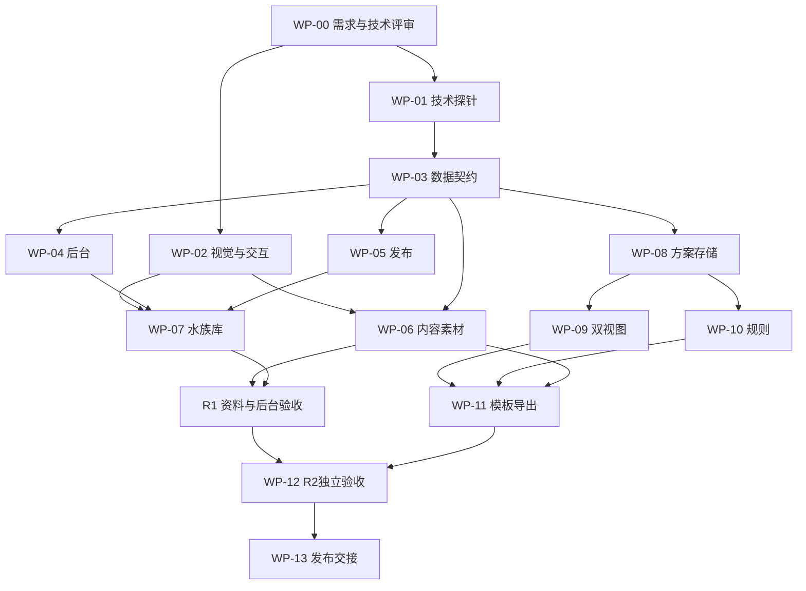

# 04 实施分工、里程碑与交付验收

日期：2026-11-06。状态：待需求与技术评审。本文件是可分派的工作计划，所有工作包均为待启动；没有实施或测试新功能。需求编号来自 [01-产品需求.md](01-产品需求.md)，实现契约见 [02-技术方案.md](02-技术方案.md)。

## 1. 责任与协作方式

| 角色 | 本轮方案责任 | 获批实施后的责任 | 交付的接受者 |
|---|---|---|---|
| 用户／项目所有者 | 需求评审、技术评审与优先级 | 范围变更、关键视觉及公开发布候选评审 | 最终签收 |
| 项目负责人／主代理 | 汇总方案、消解矛盾、维护评审记录 | 拆任务、安排依赖、控制范围、组织集成和验收；不以实现者自报完成代替验收 | 用户 |
| 产品负责人／Sol | FR-01～28、内容基线、操作与异常流程 | 核每项 AC、检查文案/未知语义、组织试用 | 项目负责人、用户 |
| 架构负责人／Sol | 架构、模型、API、版本与技术风险 | 冻结契约与依赖、代码技术审查、指导迁移和回滚 | 项目负责人、用户技术评审 |
| UI/UX 负责人／Sol | 五页规格、素材合同、技能建议 | 真实素材设计稿、组件与交互规格、视觉复核 | 产品负责人、用户视觉评审 |
| 数据与后台实施／Sol | 本轮尚未分派实施 | CMS、动态表单、目录导入、发布 worker | 架构负责人、独立 QA |
| 前台实施／Sol | 本轮尚未分派实施 | 水族库 SSR、响应式、设计器外壳及交互 | UI/UX 负责人、独立 QA |
| 场景与规则实施／Sol | 本轮尚未分派实施 | 方案文档、几何/命令、纯规则、保存导出 | 架构与产品负责人、独立 QA |
| 内容与素材负责人 | 确定首批条目、实用内容与素材工作量 | 维护者核身份/参数；素材制作与双语编辑，可由代理辅助 | 产品与设计负责人 |
| QA／独立 Sol | FR 矩阵、反例、设备与发布门 | 单独复验数据、交互、权限、旧缓存和故障恢复 | 项目负责人 |

现有并发上限为4个代理，包含主代理；实施时采用“负责人 + 最多3个执行角色”的轮换安排，不把上表解释成9个代理同时运行。职责持续存在，代理可以换班。实现者提交证据后，由另一名 QA 或评审代理复验；主代理负责裁定和交付。

建议文件责任边界：后台拥有 CMS collections/hooks、管理接口与发布任务；前台拥有路由/页面/组件；场景角色拥有 plan/scene/rules/storage 模块；架构角色审批公共 schema、迁移和版本合同。具体路径在技术探针后冻结。共享文件变更由一个责任人落地，其他角色提交变更需求，避免同时修改入口、schema和样式。

每个任务交接必须包含：WP编号、输入版本、改动范围、完成项、未完成项、测试/截图位置、依赖与已知限制。缺少这些内容只能记“待集成”，不能直接记完成。集成冲突由责任人处理，项目负责人不接受覆盖他人工作来解决冲突。

## 2. 可分派工作包

下列工程量为熟练开发者的粗估等效人日，不是代理运行时间，也不是交付日期；包含基础自检，不含照片采购/拍摄等待和最终独立 QA。G1 技术探针后重新估算。

| 工作包 | 责任角色 | 输入与依赖 | 明确交付与完成定义 | 对应需求 | 粗估 |
|---|---|---|---|---|---|
| WP-00 评审与基线 | 负责人、产品、架构 | 本评审包 | D-01～10决定归档；范围/版本/验收基线冻结；保留现站及旧路径，不改上级Unity项目 | 全部 | 1–2日 |
| WP-01 技术探针 | 架构、后台、场景 | WP-00 | 实测CMS自定义字段/认证/原子发布；双视图/PNG/移动性能；IndexedDB冲突和版本恢复；列结果及是否调整选型 | 07–08、14–15、18–21、26 | 3–5日 |
| WP-02 视觉与交互基线 | UI/UX、产品 | WP-00；技术边界由WP-01补齐 | 真实照片样本、tokens、五页桌面/手机状态稿；无拖拽操作原型；用户关键视觉意见已处理 | 05、10、12、22、24–25 | 4–6日 |
| WP-03 数据契约与迁移 | 架构、数据 | WP-01 | 核心类型/参数词典/素材/Plan/Release schema；现10动物和20译文可重复导入；legacy估算隔离；旧ID映射与空值反例 | 03–06、17–19、21–23、26 | 3–5日 |
| WP-04 后台与素材管理 | 后台 | WP-03 | 维护者登录；类型表单、分类/参数、双语草稿、素材处理、资料预览/归档；模板/规则先仅草稿；维护者可录入，API拒绝匿名写入 | 17–22 | 5–8日 |
| WP-05 内容发布与恢复 | 后台、架构 | WP-03；WP-04集成 | R1不可变catalog/素材及带capabilities的manifest，条件激活/回退、locale独立、草稿隔离；R2接入引擎包及模板门槛；失败保持旧版 | 19–21、26 | 4–6日 |
| WP-06 首批内容与资产 | 内容、素材、UI/UX | WP-02、WP-03 | 18生物/8材料/双语；R1 26照片+首页实景；R2 26双视图定义+2模板封面；每项身份/比例/裁切有检查记录 | 02、05、17、19、21–22 | 8–15日，独立内容工作 |
| WP-07 水族库与视觉整合 | 前台、UI/UX | WP-02～05；使用WP-06真实内容 | SSR首页/库/详情/材料页；三/二/一列；后台词典驱动；旧query/筛选/返回不回归；R1不开放未完成设计器 | 05、21–25 | 5–8日 |
| WP-08 方案状态与本地存储 | 场景实施 | WP-03 | 数量守恒命令、撤销20次、多方案、revision事务、跨标签冲突、副本恢复、JSON快照往返 | 03–06、09、14–15、26 | 4–6日 |
| WP-09 双视图与布置 | 场景、前台、UI/UX | WP-02、WP-08；WP-06场景资源 | 一对象双投影，尺寸/锚点/旋转/边界、纵深、两层底床；手机点选+数值和键盘流程；完整数量可定位 | 06–10、24–25 | 5–8日 |
| WP-10 分项规则与解释 | 场景、产品 | WP-03、WP-08；经编辑确认的参数 | 纯函数和固定反例；区间/目标/缸长水量/群体/条件混养；需求型增氧提醒；未知覆盖及可定位动作，无总体安全分 | 04、11–13、19、26 | 3–5日 |
| WP-11 模板、导出与闭环 | 前台、场景 | WP-05～10 | 两模板创建、详情加入、本地方案列表；同revision PNG/JSON/CSV；导入预览/未知待处理；正确版本恢复 | 01–02、10、14–16、26 | 3–5日 |
| WP-12 独立验收与修复 | QA、各责任人 | R1或R2候选冻结 | 按下述矩阵执行；真机/视觉/键盘/故障/权限/缓存证据；缺陷复测；5人任务试用在R2执行 | R1分组或01–26 | 6–10日，按失败范围复测 |
| WP-13 发布交接 | 架构、负责人、QA | WP-12及发布候选评审 | 目标环境部署清单、空环境恢复演练、整版回滚、维护者操作说明、已知限制；发布批准后才切公开入口 | 20–23、26 | 2–3日 |

WP-01探针允许最小原型但不是正式功能交付，所有探针代码必须与当前公开预览隔离。探针失败优先收紧自由度或更改实现；不能用技术困难偷偷改变一尾一实例、未知不通过和保存不丢失等产品合同。

## 3. 依赖与里程碑

| 阶段门 | 应交付的可检查结果 | 谁核验 | 未通过处理 |
|---|---|---|---|
| G0 评审基线 | 需求、取舍、技术路线和任务范围记录；用户可分项通过或退回 | 用户；负责人归档 | 相关工作不启动，已通过的独立范围可另行安排 |
| G1 设计与技术可行性 | 五页关键状态稿、真实样本；技术探针和版本/设备/上限合同 | 用户关键设计/技术选择；架构、UI/UX、QA复核 | 有证据地改方案，不能进入大面积实现后再补合同 |
| G2 R1候选 | 资料库/首页/详情/材料页/后台；18+8内容双语；26照片；发布与回退 | 产品、设计、QA，负责人汇总 | 阻塞缺陷关闭；允许内部试用但不宣称完整公开版 |
| G3 R2候选 | 两模板、全数量双视图、分项规则、本地恢复与三种导出；26对象双视图资源 | 产品、架构、UI/UX、QA | 先修任务/数据/恢复问题，再修装饰 |
| G4 发布候选 | 真机与缓存矩阵、5人试用、空环境恢复、风险和维护说明 | 用户做发布候选评审；负责人核证据 | 发布不自动随需求批准发生 |

R1可以独立投入使用。FR-17～23以R1为主，跨阶段子项见下表；FR-24～26各阶段按实际能力验收；FR-01～16以R2为主，R1只继承其中已有目录能力。R2公开首发要求R1+R2全部约定项完成；FR-27～28不在首版承诺中。

建议排期按 G0→G1→R1→R2滚动。按两名主要开发者、设计/内容可持续配合且目标环境可用的假设，完整R1+R2粗略需6–10个自然周；素材重新拍摄、版本探针失败或反馈轮次会延长。此数字仅供评审判断成本，不能换算成“多开几个代理两天完成”。优先向用户交付G1真实视觉和R1可编辑后台，避免等整个设计器完成才第一次看效果。

## 4. 工程与内容完成定义

- 工程任务：类型/schema及相关测试通过，主路径和失败状态可演示，迁移/版本兼容记录齐全，关键功能由独立角色复验；不新增无关测试，不只测实现细节。
- 内容任务：条目ID、实体类型、中文/英文、已知/未知状态明确；不是把所有字段填满才叫完成。缺数据触发未知。首发约定的真实照片及场景资源完整，运行时降级不能替代素材交付。
- 视觉任务：真实内容下五页布局、照片裁切、透明边、长名/错误/缺值、中英与手机均检查；相同数据与视口提供修改前后对照。不依靠“高级感”评分。
- 发布任务：前端、内容、规则、schema、媒体版本成组；旧标签和旧缓存能恢复；后台权限和恢复演练通过。开发no-store不代表生产一致性已完成。
- 维护交接：维护者亲自完成新增分类→录入→素材→中英预览→发布→纠错→归档/回退一次，不要求编辑JSON或提交代码。不建立来源URL/许可登记或学术审批工作流。

## 5. 风险、变更与资源

| 风险 | 提前验证/措施 | 触发范围调整时的动作 |
|---|---|---|
| 素材影响最终观感且生产量容易低估 | G1先用真实照片与两视图样本；分别跟踪26照片、26资源定义、2封面、1主图 | 明确减少条目或延后公开时间；不以通用剪影/AI鱼图充数 |
| CMS和整版发布远超静态站改造 | WP-01先验证最小草稿→release→回退 | 更换CMS或改发布路线需技术评审；不能交付假后台 |
| 参数缺失导致大量未知 | 不追求全兼容，先跑实际两模板，12显式配对保持范围 | 调整模板或补真实内容，不能自动编造参数 |
| 场景逼真度预期过高 | G1展示真实2D/2.5D样本和可编辑效果 | 需要自由3D/照片生成另立范围，不绑入本期 |
| 手机性能及素材内存 | 40正常/200压力/300上限实测，按需加载，设计器不进入资料页首屏包 | 统一降低上限或素材成本；不抽样鱼只 |
| 本地保存被误认为账号云备份 | 保存处一句说明；成功反馈严格对应事务；JSON导出与恢复测试 | 云同步、分享和账户属R3，不临时加后端个人数据表 |
| 旧缓存再现“没变化/排版乱” | 锁版本、实际旧路径和旧标签验证、完整回滚 | 故障先停新候选，保留用户方案，修版本策略 |
| 多语和动态参数扩大维护量 | 两语言、固定核心+受控扩展；维护者单角色 | 新语种、新计算语义分别估算，不把配置字段当自动算法 |
| 预算/地区未定 | D-08先定预算上限与主要服务地区，再给供应商报价 | 未定可本地/预发布验证，不进行付费生产开通 |

范围变更记录必须给出：涉及FR/WP、变更原因、前后行为、数据迁移、素材/测试/工期影响、用户决定。轻微实现细节由责任人裁定；增加介质、3D、账号云同步、公开分享、改变计量与保存合同或削减素材基线属于需评审的范围变更。

基础设施成本不写未核实套餐价：评审后对 Node运行/任务worker、Postgres备份、对象存储+CDN、认证与监控逐项估算，列固定月费和流量增量。管理员内容建议RPO≤24小时、RTO≤8小时，待所选环境恢复演练确认；匿名本地方案不纳入服务端备份承诺。

以下是独立QA的验收计划，经总稿统一口径。尚无新增功能的通过结果。

## 6. 需求与验收矩阵

各行成功标准均为待实施后的预期。数据校验、纯规则测试适合自动化；视觉、真机、键盘和实际任务须保留人工观察。不能用截图代替数量/版本断言，也不能用 DOM 通过代替视觉签收。

| 用例编号 | 需求 | 测试类型 | 成功标准与关键反例 |
|---|---|---|---|
| TC-01 | FR-01 入口承接 | 路由契约、浏览器端到端、旧链接回归 | 旧 calculator query 到模板入口；中英详情加入保留实体 ID；当前方案不被重建。无方案、已有方案、未知 ID、刷新、返回均有明确结果。外站 return 参数不产生开放重定向。 |
| TC-02 | FR-02 模板维度 | 内容/schema、集成、端到端 | 两个已发布淡水模板各可新建；改地域不改水体/结构；未发布模板不可从列表或公开 ID API 获取。模板加载失败不覆盖当前方案。 |
| TC-03 | FR-03 条件输入 | 边界/单位测试、表单端到端 | cm 输入按约定转 mm；负数、零尺寸、NaN/Infinity、超界、水位高于缸高拒绝；水位等于上限行为确定。缺温度/pH/GH仍可编辑、保存，相应结果为未知；不替用户填安全值。 |
| TC-04 | FR-04 水量 | 纯计算、单位/边界、界面口径 | 60×30cm、水深30cm、平均底床5cm、无额外排水量为45L；无底床厚度按0且标几何估计；负底床、底床高于水位、人工排水使结果≤0拒绝。未知硬景不按图片面积猜排水，不产生承载百分比。 |
| TC-05 | FR-05 目录查找 | 检索/筛选契约、双语端到端 | 中英名、学名、别名找到同一稳定 ID；鱼/虾/螺/植物/材料筛选适用；交并集语义继承。空结果可清除筛选；切分类/语言不删除已加入项目。 |
| TC-06 | FR-06 数量事实 | 命令/属性不变量、端到端、导出比对 | 添加、减量、复制、删除、撤销后清单和实例严格守恒；动物正整数，一尾一实例，无抽样；植物丛/份、石木件、底床区域分别验证。清单隐藏或场景遮挡不减量。 |
| TC-07 | FR-07 双视图 | 几何单元、往返属性测试、视觉/触控 | 同一实例 ID、选择及位置共享；正面改 x/z 不改 y，俯视改 x/y 不改 z；切视图不创建对象。缩放、DPR、画布适配不改物理坐标。正面按物理y排序，俯视重叠按z排序，同值采用稳定ID等确定顺序。 |
| TC-08 | FR-08 变换编辑 | 几何边界、命令、导入校验、视觉 | 稳定 ID；旋转后整个包围体按边界校验；植物/材料只在批准范围变尺寸；成年动物尺寸从固定快照派生，UI及恶意JSON均不能缩鱼规避规则。正面前后排列显式改变物理y并同步俯视，不另存zIndex。 |
| TC-09 | FR-09 撤销恢复 | 命令序列、端到端、中断 | 连续至少20次混合场景/清单操作可逐步撤销及重做，恢复数量/实例/坐标；撤销后新操作清理重做分支。删除整方案需确认；模板替换可保留或另建；取消不改变原方案。 |
| TC-10 | FR-10 场景可读 | 真实素材视觉审查、真机、缺资源注入 | 正面/俯视动物植物硬景可辨；密集/遮挡时清单仍可选任何实例；缺素材保留等量具名占位及编辑能力。两视图同一对象不能被计作两件；照片不能冒充透明场景资源。 |
| TC-11 | FR-11 分项规则 | 纯函数fixture、属性/回归、端到端 | 体积、缸长、群体、温度/pH/GH公共区间、条件性配对、流速/溶氧分别覆盖。修改依赖立即失效旧缓存并重算；同版本同输入确定。无生物负荷公式、通用最大条数或总安全分。 |
| TC-12 | FR-12 原因与定位 | 结果契约、键盘/读屏、任务试用 | 每条结果有对象、条件/差额及可行动建议；点选能定位真实项目或参数，删除对象后不遗留失效定位；中英消息与单位正确。不只呈红黄绿。 |
| TC-13 | FR-13 未知边界 | 缺值/覆盖fixture、聚合反例、理解试用 | unknown、needsReview、未覆盖配对、缺条件均不能pass；unknown不能掩盖明确fail。已知子集通过不代表全部通过；不适用与未知分开；未知可保存但摘要仍可发现。 |
| TC-14 | FR-14 本地方案 | IndexedDB集成、真机、中断/配额/并发故障 | 停止操作2秒内完成持久化成功反馈；至少10方案可重命名/复制/删除；刷新恢复。配额/事务失败保留当前编辑、最近可恢复副本，显示失败并能导出；两标签冲突不静默覆盖。 |
| TC-15 | FR-15 JSON导入导出 | schema/恶意输入、迁移fixture、往返集成 | 含版本、ID、完整清单/布局/条件；先预览再以新 ID 导入；原方案不变；坏文件/未来不支持版本受控拒绝。未知身份保留待处理，已识别缺资源保留占位；不执行内容、不任意联网。 |
| TC-16 | FR-16 成果文件 | 同revision一致性、视觉、CSV安全/跨域 | PNG、当前语言清单、JSON来自同一冻结revision；名称/数量/位置/未知结果对应；PNG仅简短设计示意，无遮挡关键信息；图片跨域失败可恢复。CSV中文不乱码、公式开头安全转义；无安全认证暗示。 |
| TC-17 | FR-17 内容管理 | API权限、CRUD/归档集成、后台任务 | 维护者不写JSON即可填类型字段、两语言、素材与未知状态；匿名不能新增/改/删/上传。停用后不可新选，旧方案保留原ID/修订与占位或快照，不替换成同名物种。 |
| TC-18 | FR-18 分类/参数 | 类型/引用校验、后台任务、迁移回归 | 改名称/顺序/适用类型生效且ID稳定；拒绝分类环、错单位/反向范围；被引用分类必须迁移或归档，旧引用可解析。新增展示字段不自动变规则；核心单位/类型变更有显式迁移。 |
| TC-19 | FR-19 模板/规则 | 内容校验、预览集成、权限/版本 | R1仅验模板/规则结构化草稿、版本原因和类型/引用校验，未启用designer时禁止公开；R2再验两模板预览与发布复现相同布局/数量、规则启停执行。关闭关系规则后对应项变未覆盖未知，不能变兼容；坏模板引用/无效核心字段阻止发布。 |
| TC-20 | FR-20 发布回退 | API权限、事务/并发、故障注入、预发布演练 | 草稿不能经列表/详情/媒体预览泄漏；候选显示变更与阻塞；部分上传、校验失败、并发active切换不出现半批。一次页面/评估锁定一致deployment；回退可复现上个成功build+内容+规则+素材。 |
| TC-21 | FR-21 双语发布 | 内容计数、locale发布/SEO、端到端 | R1验18生物+8材料和已公开界面中英齐全；R2再验2模板、设计器和启用规则中英齐全；后续只改zh可发新整版release且en仍为旧已发布修订。未完成locale不可见于sitemap/hreflang，不英文兜底；切语保留方案/筛选/选中。 |
| TC-22 | FR-22 照片与素材 | 资产完整性、绑定/视觉、故障注入 | R1有26张独立真实主图、R2有26个对象定义的52套双视图表示（可程序化）；身份/材质、尺寸、锚点、透明边和两语alt对应。缺图降级不当作首发齐备；AI/通用剪影不冒充照片。 |
| TC-23 | FR-23 资料库回归 | 现有回归迁移、路由/SEO、视觉 | 原10动物与20本地化、既有未知语义、同维并/跨维交、区间重叠、详情返回筛选/滚动、语言URL均保留；旧ID改slug单跳映射；新增植物不套用动物群养字段。 |
| TC-24 | FR-24 桌面/手机 | 实际桌面与真机端到端、旋转/触控 | 1440px桌面与390px目标真机完成模板→添加→布置→检查→保存→重开；软键盘、横竖屏、面板开合不遮关键控件/选中物，不重置方案。模拟器只能补覆盖。 |
| TC-25 | FR-25 无障碍 | 纯键盘、读屏抽查、缩放/对比度 | 不用鼠标或拖拽可选物、改数量/坐标/层序、删除/撤销、保存/导出；焦点有序、关闭弹层返回触发器、无键盘陷阱；200%可完成，320 CSS px回流；错误有文字、触控无hover依赖。 |
| TC-26 | FR-26 更新恢复 | 网络/404注入、缓存矩阵、迁移/回滚 | 断网保留本地；重复打开不双写；素材404等量占位；旧方案默认原快照，只有明确选择才升级并形成新revision。旧标签/旧缓存/新版plan回旧app均不得混版本或清空数据。 |
| TC-27 | FR-27 只读分享（后续） | 未来权限/隐私、版本一致性、端到端 | 单独立项后验：匿名方案默认不公开；接收方同版本只读，复制后另存；不可从分享访问草稿或后台；撤销/过期行为先定义。首版不生成伪分享链接，不以未实现阻塞首版。 |
| TC-28 | FR-28 扩展生态（后续） | 内容包合同、能力/规则、地域反例 | 单独立项后验：先完成参数/素材/覆盖才开入口；未知地域或人工品系不能证明严格原生；新介质能力须数据、引擎、前台同时支持。首版不显示不可用海水/水陆入口。 |

## 7. 必须冻结的反例集

以下均用合成测试实体或明确固定的内容修订，不把测试阈值伪装为实际物种饲养结论。测试负责人在实施后为每组保存输入JSON、预期分项结果和实际差异。

| 场景 | 固定输入与操作 | 预期 |
|---|---|---|
| 群体不足 | 已知群游最低8，数量依次1、7、8、9；另设单养/条件配对/虾群居档案 | 1/7明确不足并给差额；8只通过该群体项；不同群体模式按自身规则，不套同一底线。动物不因拖高水层或缩画布改变结论。 |
| 公共温区空 | A=[20,24]、B=[25,28]、C=[23,26] °C；不填目标 | A/B不相交，公共交集为空，冲突；不取平均温度。另测A=[20,24]、B=[24,28]，边界24可交。 |
| 合法的跨维冲突 | A温区[22,26]、pH[6,7]；B温区[24,28]、pH[7.5,8] | 温度可交不覆盖pH冲突，分项同时展示；不能选温度一项代替总体判断。实数一维闭区间两两相交必有全局交集，不制作“三个温区两两相交但全局空”的不可能样例。 |
| 目标值与范围 | 已知公共温区[24,26]，目标23、24、26、27、null | 23/27冲突，24/26通过该项，null未知；公共范围存在不代表缺目标通过。pH/GH同测边界及单位。 |
| 未知与已知空 | 温度null+unknown；数值0；集合unknown；known+none/合法空集合；notApplicable；needsReview；无成对规则 | 各状态区分；0不默认未知；未知/待确认不pass；已知空与未覆盖不混用。另置明确温度fail，聚合保留fail与unknown。 |
| 溶氧/水流 | 物种高溶氧需求，方案无实测/设备信息；另有低水流偏好 | 溶氧需求待核对，不能因水流强或有气泡装饰判满足，也不能从溶氧推断水流。 |
| 数量守恒 | 12鱼+6虾+2螺=20动物实例；3丛植物=3；2石+1木=3件；底砂1区域 | 两视图均投影同一逻辑集合；复制/删石木同步数量；遮挡/隐藏/缺资源不减少；清单改量与实例修改原子化。导出、撤销、导入后同样守恒。 |
| 数量上限 | 冻结上限N与动物上限M；分别添加/复制/模板/导入至N-1、N、N+1及M边界 | 上限内保留一动物一实例；越界统一拒绝新增事务，现数量不变；无代表显示或静默删尾。部分导入如何处理须一致，不允许半成品自动入库。 |
| 固定成年尺寸 | 保存快照成体40mm；UI尝试改20mm、导入篡改sizeMm、缩小缸体、zoom到25% | 篡改拒绝或进入修正预览；成体事实40mm不变，zoom仅视口变化；缩缸保留尺寸并提示越界，不能按比例缩鱼。 |
| 坐标与边界 | L=600,D=300,H=360mm；实例(x=120,y=80,z=150)；改变DPR/视口；正面再俯视往返 | 正面投影(120,210)，俯视(120,80)（均相机变换前）；正面拖动只改x/z，俯视只改x/y。旋转90°后按新包围体校验，不只检查中心点；底床附着对象遵守z锁。 |
| 层序与纵深矛盾 | A在前y=50，B在后y=250；用正面前后排列，再拖纵深、切视图、保存重开 | 前后排列修改物理y，俯视同步显示实际纵深；无独立zIndex覆盖几何。俯视重叠按z、同值稳定排序；在合法边界内移动，无法继续前移时不悄悄越界。保存重开次序一致。 |
| 保存故障 | 编辑后2秒前刷新、保存事务中关闭页、配额耗尽、隐私/禁存储、设备后台挂起 | 成功提示仅在提交后；已提交revision可恢复；未提交编辑明确风险且尽量保留可导出；不能声称提前关闭前必然保存成功。失败不替换最近良好副本。 |
| 多标签页 | A/B打开同一revision；A保存后B旧副本保存；重复打开/重复导入确认 | revision条件写/锁或等价冲突保护；B需重新加载或另存副本，不最后写入者静默覆盖；重复回调不重复加数量。 |
| 恶意文件 | 无效JSON、未来schema、5MB候选上限±1、过深嵌套、超长字符串、重复ID、悬空引用、NaN式文本、错误单位、__proto__、脚本/HTML、外链URL、CSV公式开头名称 | 有界受控校验，原方案零变化；禁止执行、原型污染、任意URL加载和CSV公式执行。解析失败定位可理解；不把未识别对象静默丢掉。具体大小/深度/数量阈值先冻结。 |
| 旧版回放 | 已保存R1；目录改尺寸/名称/规则后发布R2；重开R1，再明确升级 | 默认仍R1快照、成年尺寸和带版本旧结果；旧结果若无法复算须显示历史/不可重算，不能调用新引擎伪装旧结论；升级生成新revision及差异，不覆盖R1。 |
| 新plan回旧app | 新build写schema2方案后回滚schema1旧build；旧标签读新方案 | 原始数据完整保留，旧build受控提示不支持/升级，可导出；不自动降版、删库或覆盖成空方案。已知旧schema仍可打开。 |
| CMS匿名写/草稿读取 | 未登录直接调用集合CRUD、上传、预览、候选创建、激活/回滚；猜草稿ID | 服务端拒绝写和受保护读，不靠隐藏按钮；公开资源及缓存无草稿/内部备注；有会话也逐资源鉴权；失效会话/CSRF按认证合同拒绝。 |
| 分类归档 | 分类被两条目、旧release和旧方案引用；尝试删除、改ID/单位、停用 | 无悬空引用；新选择隐藏归档项，旧展示/回放可解析；变单位不把cm旧值直接当mm，必须显式迁移。 |
| locale独立发布 | 初发中英齐；后续只zh完成、en仍草稿；发布zh更新 | 一个新整版release冻结zh新修订+en旧公开修订；en草稿不可读；不存在语言不入SEO链接；任何页面不拼接未发布翻译或英文兜底。 |
| 版本/缓存/原子回退 | A旧页保持开启；发布B；部分上传故障、CDN旧节点、激活409、hash错；回退A | A继续整套A或受控升级，B始终整套B；单次评估版本元组一致。失败不切active，回退为完整A；保留本地方案。旧HTML不得调用无版本“最新”JSON补洞。 |
| 双素材门槛 | 一实体有照片无俯视素材；另一有场景图无照片；主图404；尺寸/物种错绑定 | 运行时均可恢复，但各自不能通过R1照片/R2场景完整门。52套视图表示可为程序化；不得把照片复制一遍算俯视或用同图充多个实体。 |

12动物共有66个不同物种配对，验收查询行为覆盖全部66对；至少12条显式关系逐条检查具体条件，剩余未覆盖项均应明确未知。并不要求编造66个兼容结论。模板默认无已知冲突、输入完整；实际资料缺口仍列未知，不能用更少红色宣称安全。

## 8. 设备与性能预算落地

下表是评审提案，尚未测量。技术评审须登记具体型号、OS、浏览器版本、CPU/内存、DPR、资源数据集和部署环境；“中端手机可用”不构成证据。建议以发布时Chrome/Edge/Firefox最近两个稳定大版本和Safari/iOS当前及前一大版本为候选支持矩阵；最低真机设备、动物/节点上限和导入上限应在技术探针后冻结，未达标时先减少贴图成本或收紧公开上限，不牺牲一动物一实例。

| 设备/条件 | 验收覆盖 |
|---|---|
| 目标桌面实际Chrome，1440px | 全流程、40实例正常场景、200/300节点候选压力、导出、版本/缓存；录屏并采性能trace。 |
| macOS Safari及Firefox/Edge候选覆盖 | 保存、Blob/PNG、IndexedDB、布局/键盘和旧链接冒烟；正式支持矩阵在技术评审选定。 |
| 一台实际中端Android Chrome，约390px | 触控完整流程、软键盘、后台恢复、40实例拖动、自动保存、下载/文件导入；禁止只用桌面模拟390px替代。 |
| 一台实际iPhone Safari，接近390px | IndexedDB受限/恢复、文件下载/分享、触控/屏幕旋转、视口/安全区和焦点；记录与Android差异。若资源仅够一台，另平台须明确延期风险并由评审定支持范围。 |
| 1280/1024/768/390/320 CSS px，中英，200% | 五页关键状态、窄屏回流、长学名/错误文案、画布容器滚动、键盘及保存/导出。 |
| 目标预发布服务器，冷缓存/热缓存/受限网/离线 | 首屏、设计器懒加载、素材404/超时、active响应头、完整版本绑定和回退；不能只测本地no-store。 |

建议正常任务基线为40个可见实例；200/300节点另行作为压力/上限。候选预算：40实例拖动的帧间隔p95≤33ms，交互到可见反馈p95≤100ms；条件/数量修改后规则结果p95≤500ms；停止编辑到IndexedDB事务提交≤2s（失败须进入失败反馈）。压力探针用200节点尝试30fps，300节点必须能完整保存、重开及导出，是否仍要求拖动30fps待真机测量后定；此处节点=逻辑SceneObject+底床层，含缺资源占位，不含背景、选框、单个对象内部的Konva子节点；动物≤200和总节点≤300分别校验。

公共页可提议LCP≤2.5s、INP≤200ms、CLS≤0.1；新站无真实用户分位数据前仅记录固定网络条件下的实验室近似值，后续具备样本再看75分位。设计器起开、PNG导出、JSON导入、峰值内存另在真实26套素材准备后测量并冻结预算；不把未定数值当通过。建议PNG导出候选≤5s，期间可见进度且不误重复触发；评审确认前作为观察项。页面加载/导出至少5次报告单次值与最大值；规则/反馈延迟每设备至少30次、拖拽至少30秒采样，p95用nearest-rank计算，并报告数据集，不只给最好一次或平均数。功能保存测试独立验证一次次真实提交，不被性能分位统计掩盖。

## 9. 试用与人工签收

实施后安排5名爱好者：3名首次或计划首次开缸，2名有一年以上经验；桌面3人、真手机2人。主持人只读任务，不代点、不解释控件；记录是否求助、卡点、用时和误解。任务为选模板，设60×30×36cm，添加指定生物/植物/石木，改数量，修正一个群体不足，调整正面/俯视，保存，导出再导入，并有意加入资料未知对象。

候选门槛：至少4/5无需代操作在15分钟内完成主任务；5/5能找到保存或导出；至少4/5说明一个具体问题与修正动作；5/5知道有未知不能保证整缸安全。5份导出再导入的数量、坐标、条件须全部一致，刷新恢复无已成功提交数据丢失。5人试用仅发现任务与理解风险，不证明统计上的普遍易用。理解失败、数据损失和无法完成流程须修复，再对失败任务重测。

人工质量分开签收：设计负责人检查五页中英真实内容的布局、照片裁切与透明边；产品/内容负责人核身份、未知表达、模板与规则解释；QA核功能、权限、版本和恢复；用户签关键视觉、任务与发布候选。审查不要求逐字段来源登记或学术认证。用户偏好“布局说明用途”，检查不必要眉题、装饰标签和重复说明，不以密集注释掩盖状态模型问题。

纯键盘验收另独立进行：从首页开始，不碰鼠标完成查询→加入→改数量→改x/y/z及允许变换→调层序→读错误→撤销→保存→导出；再核焦点回返、Esc关闭、Tab顺序和读屏对象表。真手机走不拖拽路径，确认方向步进、数值控件、清单选择足够完成同任务。

## 10. 严重度与放行

| 严重度 | 本项目判据 | 放行规则 |
|---|---|---|
| P0 | 匿名/越权管理写入或草稿重大泄漏；可执行恶意导入；大范围不可恢复方案丢失 | 立即停止候选发布；修复并补反例回归、核实影响范围；已上线时执行已演练回滚/隔离。 |
| P1 | unknown变pass/安全结论、数量或成年尺寸错误、双视图失真、已保存数据丢失、混版本、回退失败、主流程在支持设备/键盘阻塞、首发双素材/中英缺口 | 首版零未关闭P1；不能用告知用户或暂用占位豁免。确需减范围必须由用户明确改需求及基线，再重评相关验收。 |
| P2 | 有恢复路径的次要功能问题、非关键布局/裁切或次级设备问题，未影响数据/规则正确性 | 有明确影响、替代方式、责任人和修复时点；产品/技术/设计按归属接受，用户发布候选评审可复核。 |
| P3 | 轻微视觉/文案一致性，不影响理解或完成任务 | 可记录后续修复；不因累计轻微问题掩盖整体视觉未签收。 |

放行须同时满足：FR-01～26约定AC及高风险反例全部通过；P0/P1为0；首批内容、26照片与26双视图资源定义齐；两模板能复现且无已知冲突；真实目标手机、键盘、保存恢复、升级/旧缓存/回退演练通过；性能达到已冻结预算；5人试用达到约定门槛；已接受P2和未支持范围透明列出。R1可以独立签资料与CMS，但设计器公开首发必须R1+R2完成。FR-27～28不阻塞首版，也不能写成已交付。

本轮仅交方案。评审后按用户批准的具体工作范围启动，不额外重复请求已覆盖的安装或编码权限；公开发布是否授权以用户明确决定为准，需求评审本身不冒充发布候选批准。本轮文档不能写“验收通过”。

## 11. 证据与交付目录建议

未来每个候选建立一个只增不改的证据目录，索引串联FR、用例、输入revision、预期/实际、失败单及复测。最小证据如下：

1. 基线：部署/前端build/content release/ruleset/engine/plan schema/asset manifest版本元组、锁定依赖、18+8条目ID清单、两模板快照、两语完整性与引用校验报告；测试数据与实际物种内容分开。
2. 规则：高风险fixture输入和分项预期/实际、66配对查询覆盖、12条显式规则条件、旧估算隔离证明；含unknown不pass、端点交集、目标超界、跨维冲突与群体不足。
3. 数量/场景：添加/复制/删减/撤销序列日志、清单—实例—双视图—导出同revision比对；标尺/坐标/旋转/层序截图和真机录屏。遮挡场景附逻辑实例统计，不能仅目数图片。
4. 存储：10方案恢复、多标签冲突、配额失败、事务中断/刷新、旧版本迁移、新plan回旧app；保留输入文件hash、导出文件及原数据未被覆盖的比对。
5. CMS与发布：匿名/越权API状态及服务端拒绝结果，草稿不可见、分类归档、locale独立候选、部分上传/并发active冲突、hash错误与完整回退记录；脱敏，不存会话密钥。
6. 缓存：全新浏览器、保留缓存/本地数据、升级前旧标签、普通刷新、后退前进、深链接、切语、旧方案重开各自截图和网络响应头；保存真实旧访问路径。证明HTML/JS/CSS/JSON/素材的完整版本元组，不依赖硬刷新。
7. 人工：每张截图URL、语言、视口、DPR、OS/浏览器、发布和数据版本、缓存场景；关键页面分段图加实时视口，避免全页拼接异常误判；真实照片/场景资源分别签收。
8. 性能、5人任务原始观察及未解决问题；空环境备份恢复与回滚演练时间（RPO/RTO预算由运维评审确认）；发布签收清单注明谁在何时接受何项，绝不写尚未执行的通过率。

## 12. R1/R2阶段子验收（消除跨阶段依赖）

| 需求/能力 | R1必须完成 | R2追加门槛 |
|---|---|---|
| FR-19 模板与规则后台 | 草稿录入、字段/引用校验、版本及修改原因；公开不能获取未完成内容 | 双视图预览、规则运行/启停、两模板完整发布与复现 |
| FR-20 发布 | catalog-only快照、照片、一个active、资料预览、旧标签/缓存、发布失败和整版回退 | designer能力与引擎/场景原子绑定；旧方案/引擎包及回滚恢复 |
| FR-21 双语 | 18生物/8材料、已公开UI/养护说明中英齐；locale独立发布 | 2模板、设计器界面和启用规则消息中英齐 |
| FR-22 素材 | 26真实主图+首页实景；缺图降级 | 26对象定义/52视图表示+2模板封面；缺场景资源等量占位 |
| FR-24/25 设备与无障碍 | 首页/库/详情/材料/后台任务 | 设计器触控、键盘与画布对象表 |
| FR-26 恢复 | 内容整版回退、旧链接兼容；稳定envelope的只读备份恢复壳 | 多方案自动保存、迁移、旧引擎、未知导入项、版本升级及完整恢复 |

R1发布器不校验尚未启用能力的模板可打开性、规则执行和双视图资源数量，不要求加载空引擎假装通过。R2发布前完整增加这些门槛。WP-05发布服务在R1完成能力闸门，WP-11接入designer；WP-12分别执行上表对应子集。旧R1若没有只读恢复壳，不能作为产生过本地方案之后的回退目标。
