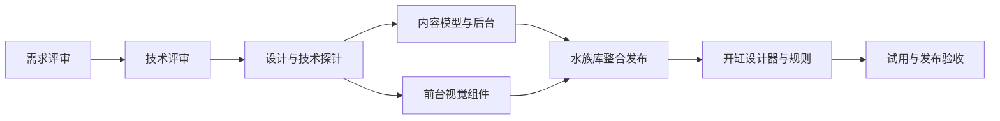

# FishAtlas 水族库、后台与开缸设计：评审包

> 后续状态：用户已于本轮明确授权“安排sol安装技能并实施吧”。推荐本地实施路线已启动，执行计划与实时记录见 [实施计划](../../superpowers/plans/2026-11-06-aquatic-platform.md) 和 [实施进度](../../implementation/2026-11-06-progress.md)。下文保留原评审提交时的状态；生产供应商、付费资源及公开上线尚未执行。

日期：2026-11-06（Asia/Shanghai）  
版本：0.1 / 需求与技术评审候选稿  
状态：**等待项目所有者评审；未授权实施本轮新增功能。**

本轮由项目负责人组织产品、技术架构、设计与独立质量评审。交付物是可以据此拆任务的方案，不是功能完成声明。未改动网站代码、内容数据或运行服务，未安装技能或依赖。

## 1. 建议的产品方向

围绕“查资料 → 设计一缸 → 得到可继续编辑的搭建方案”组织网站。水族库提供生物资料，后台维护生物、植物、材料和模板；开缸设计承接原 P1 计算器，提供二维场景编辑与分项条件检查。

首批建议仅支持淡水全水缸，使用两套模板和精选内容形成完整闭环。海水、水陆、严格原生复刻、自由三维编辑、AI 养成效果、社区与交易均不计入首批承诺。

## 2. 阅读与评审顺序

| 文件 | 评审重点 |
|---|---|
| [01-产品需求.md](01-产品需求.md) | 用户目标、范围、FR 需求编号、操作流程、异常状态、内容规模、验收条件 |
| [02-技术方案.md](02-技术方案.md) | 技术取舍、CMS、领域模型、场景与方案契约、接口、规则、发布、迁移和运行 |
| [03-设计方案.md](03-设计方案.md) | 五个关键界面、视觉方向、交互、素材、移动端、技能组合与设计验收 |
| [04-实施与验收.md](04-实施与验收.md) | 角色分工、工作包、依赖、交付门槛、测试矩阵、风险与工作量 |
| [05-评审记录.md](05-评审记录.md) | 需要你决定的产品和技术事项、内部审查结论、意见记录格式 |

建议先完成需求评审，再做技术评审。技术探针、设计稿制作、技能安装与编码均在相关评审批准后启动。

## 3. 当前事实与候选目标

| 项目 | 已有事实 | 本轮候选目标 |
|---|---|---|
| 前台 | 原生 JS/CSS、JSON、Python 本地预览 | 支持发布内容的公共前台与独立加载的设计器 |
| 内容 | 10 个动物条目（9 鱼、1 虾），20 条中英本地化 | 原 10 个 + 2 种螺 + 6 种植物，共 18 个生物；8 个材料条目 |
| 图片 | 没有正式物种照片 | 建立真实照片与场景素材的不同交付要求 |
| 分类与参数 | 部分字段、枚举和翻译写在前台/校验器中 | 后台维护词表和有类型的扩展参数；核心规则字段有稳定契约 |
| CMS | 无后台、无内容数据库 | 管理员可完成录入、预览、发布、归档和回退 |
| 开缸功能 | 只有占位页；两个方案 JSON 是空数组 | 两套淡水模板、2D/2.5D 预览、清单、分项检查、本地保存和导出 |
| 发布 | 已修复本地缓存混载；资源带版本，预览 no-store | 生产使用不可变发布版本，页面、资源与内容保持兼容，可整版回退 |

这里的数量是开发与体验验证的候选基线，不等于宣称现有内容已全部核实。旧 PRD 的“每语种 50 个核心鱼种”仍是历史内容扩充目标；是否延后该目标并优先完成本轮闭环，列入需求评审，不默认为已获批准。

## 4. 已知约束与尚未批准的选择

继承用户约束：爱好者整理分享定位；不建立逐字段来源 URL、许可登记或学术审核门槛；不使用 AI 图片冒充真实物种照片；减少多余标签和说明；中英双语；本轮先做方案。

以下均为项目组建议，等待评审：首批具体内容规模、仅淡水全水场景、二维编辑路线、匿名本地保存、后台技术栈、生产部署、视觉方向、开发顺序与工作量。

## 5. 角色与责任

| 角色 | 本轮承担者 | 责任与交付 |
|---|---|---|
| 项目负责人 | 主代理 `/root` | 范围收敛、跨角色决策、文档整合、依赖和验收把关；不把建议写成用户已批准 |
| 产品负责人 | Sol `/root/review_product_owner` | 用户路径、范围、需求编号、内容与规则语义、产品验收 |
| 技术架构师 | Sol `/root/review_architect` | 架构选择、数据/API、场景契约、CMS、发布/迁移/运维 |
| UI/UX 设计负责人 | Sol `/root/review_design_lead` | 视觉与交互规范、关键页面、素材、技能使用和设计验收 |
| 独立质量负责人 | Sol `/root/review_qa_lead` | 28项需求验收矩阵、故障反例、真机/性能、发布门 |
| 独立实施可行性复审 | 新的独立 Sol 评审代理 | 从实施者视角找重大歧义，检查最终方案是否可分派执行 |
| 项目所有者 | 用户 | 需求评审与技术评审；确定本轮范围和关键技术决策 |

角色意见和事实材料保存在 `inputs/`；最终评审以本目录 01–05 文件为准，内部输入稿不单独构成开发承诺。

## 6. 开工与完成的边界

需求通过不自动等于技术选型通过；技术通过不代表视觉稿已验收。通过的阶段可在其边界内推进，未通过的事项保持待办。任何大范围扩缸型、改存储方式或改变场景精度的决定，都要更新需求、数据契约和验收矩阵。

本方案不承诺生物学安全认证、精确生态模拟、自动最大放养数量或实际植物生长效果。产品必须说明哪些条件已检查、哪些存在冲突、哪些暂不能评估。
